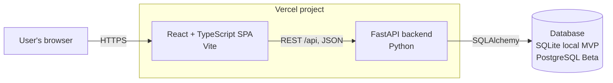
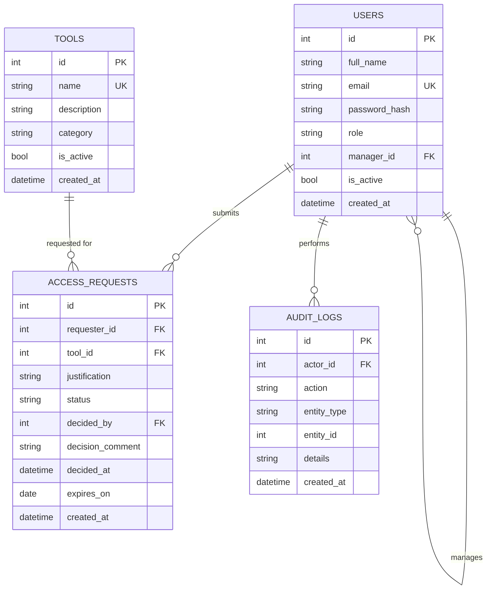
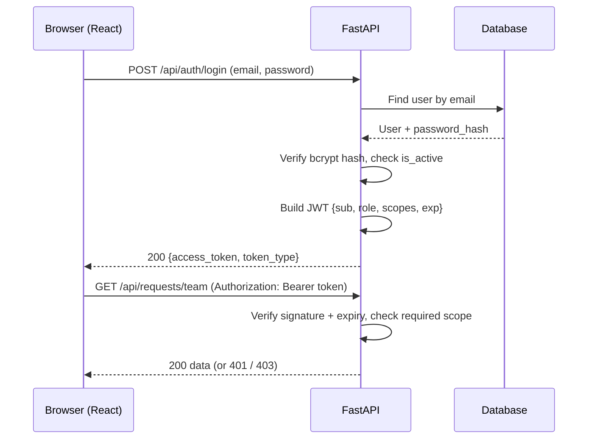

# Technical Design Document (TDD): AccessDesk

| Field | Value |
|---|---|
| Project | AccessDesk |
| Course | CSE309 |
| Version | 1.0 (Draft) |
| Date | October 2026 |
| Author(s) | [Md. Ahsan Habib] |
| Related documents | 01-prd.md, 02-srs.md |

---

## 1. Introduction

This document describes how AccessDesk will be built to meet the requirements in the SRS. Items are tagged **MVP** or **Beta** like in the other documents.

## 2. Architecture

AccessDesk is a three-tier web application deployed as one Vercel project: a React single-page app, a FastAPI REST backend, and a relational database.



- `vercel.json` (from the base template) sends `/api/*` to the backend and everything else to the frontend, so both share one domain and CORS is not needed in production.
- In local development, Vite forwards `/api` requests to the backend on port 8000.

### 2.1 Backend layers

| Layer | Responsibility |
|---|---|
| Routers | HTTP endpoints, request/response handling, scope dependencies |
| Schemas (Pydantic) | Input validation and response shapes |
| Services | Business rules (duplicate pending request, no self-approval, status transitions, audit writing) |
| Models (SQLAlchemy) | Database tables |
| Core | Settings, password hashing, JWT creation and verification, scope definitions |

## 3. Technology Stack

| Area | Choice | Reason |
|---|---|---|
| Frontend | React + TypeScript (strict), Vite | Required by the course; type safety |
| Routing | React Router | Protected routes |
| HTTP client | `fetch` wrapper (or axios) | Attaches the token, handles errors in one place |
| Backend | FastAPI, Python 3.10+ | Required; automatic validation and interactive docs at `/api/docs` (set with `FastAPI(docs_url="/api/docs", openapi_url="/api/openapi.json")`, because `vercel.json` only sends `/api/*` to the backend) |
| ORM | SQLAlchemy 2 | Database independent (SQLite and PostgreSQL) |
| Migrations | Alembic | Versioned schema changes |
| Auth | PyJWT, bcrypt | Standard, simple |
| Database | SQLite (MVP), Neon PostgreSQL (Beta) | Free; SQLite files do not persist on Vercel |
| Testing | pytest + FastAPI `TestClient` | Fast API tests |
| Hosting | Vercel Hobby | Free; matches the base template |

## 4. Database Design



### Table notes

| Table | Notes |
|---|---|
| `users` | `role` is one of `employee`, `manager`, `admin`. `manager_id` points to another user (self-reference). `password_hash` is empty or unused in MVP and required in Beta. |
| `tools` | Deactivated with `is_active = false` instead of being deleted, so old requests stay valid. |
| `access_requests` | `status` is one of `pending`, `approved`, `rejected`, `cancelled`. `expires_on` is the optional stretch feature. Index on `(requester_id, status)` and `(tool_id)`. |
| `audit_logs` | Insert-only; no update or delete endpoints. `details` holds a short text or JSON summary of the change. |

Roles map to scopes in a constant in `core/scopes.py` (the matrix in SRS section 4.2), not in a table. This keeps the schema small.

## 5. API Design

Endpoints, scopes and status codes are listed in SRS section 5. Examples:

**Create request** `POST /api/requests`

```json
{ "tool_id": 3, "justification": "Need read access to the staging environment for the Q4 migration." }
```

Response `201`:

```json
{
  "id": 12, "tool_id": 3, "requester_id": 5, "status": "pending",
  "justification": "Need read access to the staging environment for the Q4 migration.",
  "created_at": "2026-10-20T09:15:00Z"
}
```

**Decide request** `PATCH /api/requests/12/decision`

```json
{ "decision": "rejected", "comment": "Please request the read-only role instead." }
```

Response `200`: the updated request with `status: "rejected"`, `decided_by`, `decided_at`.

**Error example** (`403`):

```json
{ "detail": "Not enough permissions" }
```

### Business rules in the service layer

1. Create: tool must be active; requester must have a manager (else 409); no existing pending request for the same user and tool (else 409).
2. Cancel: only the requester, only while `pending`.
3. Decide: request must be `pending`; the decider must be the requester's assigned manager; the decider must not be the requester; `comment` is required for `rejected`.
4. Every successful write also inserts an `audit_logs` row, in the same database transaction.

## 6. Authentication and Authorization Design (Beta)

### 6.1 Login flow



### 6.2 Token

- Algorithm HS256, signed with `JWT_SECRET` (environment variable).
- Claims: `sub` (user id), `role`, `scopes` (list), `exp` (60 minutes).
- Scopes are copied from the user's role at login. If an admin changes someone's role, the change applies at their next login; the short expiry limits the delay.
- On every request the backend also loads the user and checks `is_active`.

### 6.3 Scope enforcement

The login endpoint uses FastAPI's `OAuth2PasswordRequestForm`, so the `/api/docs` page has a working **Authorize** button for testing. Scopes are checked in one shared dependency:

```python
oauth2_scheme = OAuth2PasswordBearer(tokenUrl="/api/auth/login", scopes=SCOPE_DESCRIPTIONS)

def get_current_user(security_scopes: SecurityScopes,
                     token: str = Depends(oauth2_scheme),
                     db: Session = Depends(get_db)) -> User:
    payload = decode_token(token)                 # 401 if invalid or expired
    for scope in security_scopes.scopes:
        if scope not in payload.get("scopes", []):
            raise HTTPException(status_code=403, detail="Not enough permissions")
    user = db.get(User, int(payload["sub"]))
    if user is None or not user.is_active:
        raise HTTPException(status_code=401, detail="Invalid user")
    return user

@router.patch("/{request_id}/decision")
def decide(request_id: int, body: DecisionIn,
           user: User = Security(get_current_user, scopes=["requests:approve"]),
           db: Session = Depends(get_db)):
    ...
```

### 6.4 MVP placeholder

In MVP the same dependency name exists but reads the `X-User-Id` header and checks the role in code. In Beta only the body of `get_current_user` changes (token instead of header), so the routers stay the same.

### 6.5 Frontend side

- An `AuthContext` stores the token and the decoded user (role, scopes). The token is kept in `localStorage` so a refresh keeps the session. This is simple but readable by injected scripts, so the app avoids rendering unescaped user input (React escapes by default).
- A `ProtectedRoute` component redirects to `/login` when there is no valid token and shows a "Not allowed" page when a required scope is missing.
- A `hasScope("requests:approve")` helper hides buttons and menu items. This is for usability only; the backend decides.
- The API client adds `Authorization: Bearer <token>` and, on a `401`, clears the token and redirects to login.

## 7. Frontend Design

| Route | Page | Needed scope | Release |
|---|---|---|---|
| `/login` | Login | none | Beta |
| `/` | Profile dashboard | `profile:read` | Beta |
| `/tools` | Tool catalog | `tools:read` | MVP |
| `/requests/new` | New request form | `requests:create` | MVP |
| `/requests/mine` | My requests | `requests:read:own` | MVP |
| `/requests/team` | Team requests, approve/reject | `requests:read:team` | MVP |
| `/admin/tools` | Manage tools | `tools:manage` | MVP |
| `/admin/users` | Manage users | `users:manage` | MVP |
| `/admin/requests` | All requests | `requests:read:all` | MVP |
| `/admin/audit` | Audit log | `audit:read` | Beta |

In MVP a **user switcher** in the header lets the developer act as any seeded user; it is removed in Beta. TypeScript interfaces in `src/types/` mirror the API response shapes.

## 8. Project Structure

```
accessdesk/
├── docs/
│   ├── 01-prd.md
│   ├── 02-srs.md
│   └── 03-tdd.md
├── backend/
│   ├── main.py              # entry point kept from the base template; creates app, includes routers
│   ├── requirements.txt
│   ├── alembic.ini
│   ├── alembic/             # migrations
│   ├── app/
│   │   ├── core/            # config.py, security.py (hash + JWT), scopes.py (role -> scopes)
│   │   ├── db/              # session.py, base.py
│   │   ├── models/          # user.py, tool.py, access_request.py, audit_log.py
│   │   ├── schemas/         # Pydantic models
│   │   ├── routers/         # auth.py, users.py, tools.py, requests.py, audit.py
│   │   ├── services/        # request_service.py, audit_service.py
│   │   └── deps.py          # get_db, get_current_user
│   ├── scripts/seed.py      # creates first admin and sample data
│   └── tests/
├── frontend/
│   └── src/
│       ├── api/             # client + per-resource functions
│       ├── auth/            # AuthContext, ProtectedRoute, hasScope
│       ├── components/
│       ├── pages/
│       ├── types/
│       └── App.tsx          # routes
├── vercel.json
└── README.md
```

## 9. Configuration and Secrets

| Variable | Purpose |
|---|---|
| `DATABASE_URL` | SQLite file path locally; pooled PostgreSQL URL in Beta |
| `JWT_SECRET` | Signing key for tokens (long random string) |
| `JWT_EXPIRE_MINUTES` | Token lifetime (default 60) |

Local values live in a `.env` file that is listed in `.gitignore`. On Vercel they are set as project environment variables.

## 10. Error Handling

- FastAPI validation errors return `422` with field details.
- Business rule violations raise `HTTPException` with 400, 403, 404 or 409 and a readable `detail`.
- The frontend API client maps responses to user-facing messages and handles `401` globally.

## 11. Testing Strategy

| Type | Tool | Coverage |
|---|---|---|
| Backend API tests | pytest + `TestClient`, separate test database | Request lifecycle (create, cancel, approve, reject), business rules, audit entries written |
| Authorization tests | pytest | For each protected endpoint: no token → 401, wrong role → 403, right role → success |
| Manual checks | Browser + `/api/docs` | Each role's flow end to end; demo checklist before each demo |

## 12. Deployment

1. Create a hosted PostgreSQL database (Neon free tier) and copy its pooled connection string.
2. Add `DATABASE_URL`, `JWT_SECRET` and `JWT_EXPIRE_MINUTES` to the Vercel project environment variables.
3. Run migrations (`alembic upgrade head`) and the seed script from a local machine against the hosted database. Migrations are not run inside the deployed function.
4. Push to `main`; Vercel builds and deploys automatically.
5. Smoke test: `/api/health`, login as each role, one full request flow.

Notes: serverless functions open many short-lived connections, so the pooled URL is used. The first request after idle time may be slow (cold start; free database may also resume from sleep).

## 13. Development Workflow

- One GitHub Issue per task (for example "Add project documentation").
- One feature branch per issue, named `<yourname>/#<issue-number>-<short-description>`, for example `ahsan/#1-add-project-docs`.
- Small commits with clear messages; changes merged through a Pull Request whose description contains `Closes #<issue-number>` so the issue closes on merge.
- `main` always stays deployable.

## 14. Milestones

| Milestone | Content |
|---|---|
| Documentation | PRD, SRS, TDD in `docs/` |
| MVP (mid-term) | Models, migrations, CRUD APIs for tools, users, requests; audit writing; basic React pages; runs locally |
| Beta (final) | Login and JWT, RBAC and scopes, protected routes, profile dashboard, audit viewer, PostgreSQL and Vercel deployment, tests |
| Stretch | Request expiry date |
