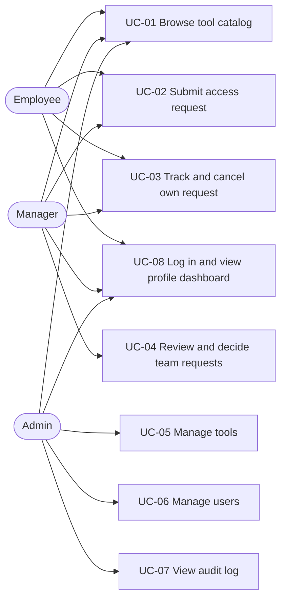
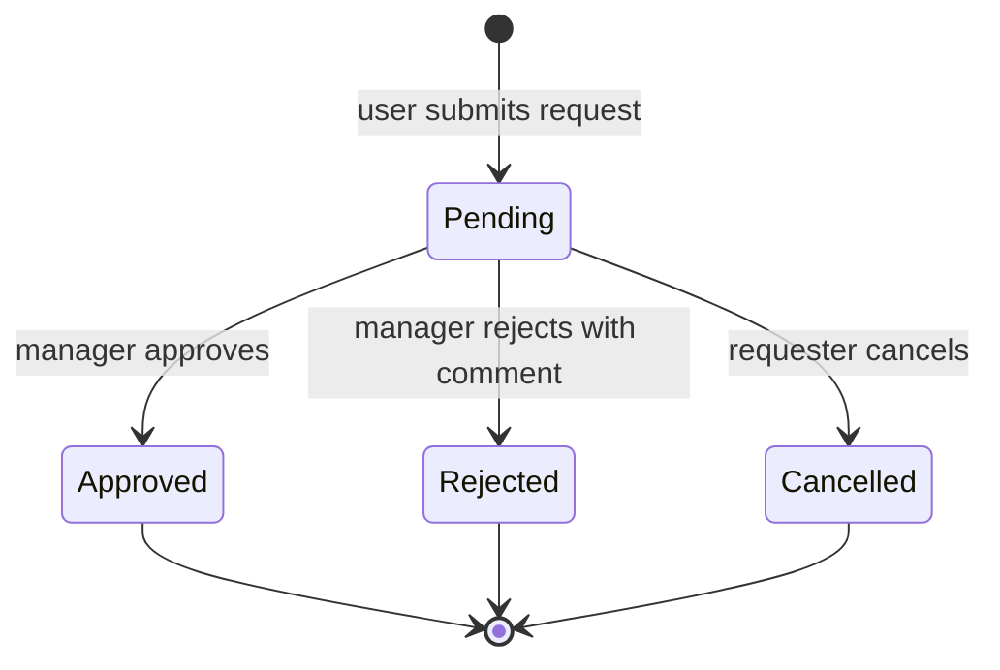

# Software Requirements Specification (SRS): AccessDesk

| Field | Value |
|---|---|
| Project | AccessDesk |
| Course | CSE309 |
| Version | 1.0 (Draft) |
| Date | October 2026 |
| Author(s) | [Md. Ahsan Habib] |
| Related documents | 01-prd.md, 03-tdd.md |

---

## 1. Introduction

### 1.1 Purpose
This document specifies the functional and non-functional requirements of AccessDesk, a web application for requesting, approving and auditing access to company tools.

### 1.2 Scope
AccessDesk lets employees request access to tools, managers approve or reject requests, and admins manage tools, users and the audit log. It records decisions only; it does not create accounts in external tools.

### 1.3 Definitions

| Term | Meaning |
|---|---|
| RBAC | Role-Based Access Control: permissions are given to roles, and users get permissions through their role. |
| Scope | A named permission (for example `requests:approve`) stored in the user's access token. |
| JWT | JSON Web Token, a signed token that proves who the user is and what scopes they have. |
| MVP | First release for the mid-term demo (local, core features). |
| Beta | Second release for the final demo (authentication, RBAC, scopes, deployment). |

### 1.4 Release tags
Every requirement is tagged **MVP** or **Beta** to show which demo it belongs to.

## 2. Overall Description

### 2.1 Product perspective
A standalone web application: a React + TypeScript single-page frontend talks to a FastAPI backend through a REST API under `/api`. Data is stored in a relational database (SQLite locally in MVP, PostgreSQL in Beta).

### 2.2 User classes

| Role | Summary |
|---|---|
| Employee | Browses tools, submits and tracks own requests. |
| Manager | Everything an Employee can do, plus views and decides requests from direct reports. |
| Admin | Manages tools and users, views all requests and the audit log. |

### 2.3 Operating environment
Modern desktop browser (Chrome, Firefox, Edge, Safari). Backend: Python 3.10+. Frontend: Node.js 22+. Deployment: Vercel (frontend and backend as one project) with hosted PostgreSQL.

### 2.4 Constraints
- Frontend must use React with TypeScript; backend must use FastAPI with Python.
- All functionality is exposed through REST APIs.
- Only free-tier services.

### 2.5 Assumptions
- Each Employee and Manager has exactly one assigned manager (the approver).
- A user with no assigned manager cannot submit requests.
- Nobody can decide their own request.

## 3. Functional Requirements

### 3.1 Tool catalog

| ID | Requirement | Release |
|---|---|---|
| FR-01 | The system shall list all active tools. | MVP |
| FR-02 | The system shall show the details of one tool (name, description, category). | MVP |
| FR-03 | An admin shall be able to create a tool. The tool name must be unique. | MVP |
| FR-04 | An admin shall be able to update a tool. | MVP |
| FR-05 | An admin shall be able to deactivate a tool. Deactivated tools cannot be requested, but existing requests stay on record. | MVP |

### 3.2 User management

| ID | Requirement | Release |
|---|---|---|
| FR-06 | An admin shall be able to create a user with name, email (unique), role and assigned manager. | MVP |
| FR-07 | An admin shall be able to list, update and deactivate users. | MVP |
| FR-08 | The assigned manager of a user must be an active user with the Manager role. | MVP |

### 3.3 Access requests

| ID | Requirement | Release |
|---|---|---|
| FR-09 | A user shall be able to create a request for an active tool with a justification of at least 10 characters. | MVP |
| FR-10 | The system shall reject a new request if the same user already has a pending request for the same tool (409). | MVP |
| FR-11 | The system shall reject a request from a user with no assigned manager (409). | MVP |
| FR-12 | A user shall be able to list their own requests, optionally filtered by status. | MVP |
| FR-13 | A user shall be able to cancel their own request while it is pending. | MVP |
| FR-14 | A manager shall be able to list requests from their direct reports, optionally filtered by status. | MVP |
| FR-15 | A manager shall be able to approve or reject a pending request from a direct report. A comment is required when rejecting. | MVP |
| FR-16 | The system shall not allow a user to decide their own request, and shall only accept decisions on pending requests. | MVP |
| FR-17 | An admin shall be able to list all requests. | MVP |
| FR-18 | The system may let a user set an optional expiry date on a request, and shall show approved requests past that date as expired. | Beta (stretch) |

**Request status flow:** `pending` → `approved` | `rejected` | `cancelled`. Approved, rejected and cancelled are final.

### 3.4 Audit log

| ID | Requirement | Release |
|---|---|---|
| FR-19 | The system shall write an audit entry (actor, action, entity, entity id, time, details) for every create, update, deactivate, cancel and decision action. | MVP |
| FR-20 | An admin shall be able to list audit entries and filter by actor, action and date range. | Beta |

### 3.5 Authentication and authorization

| ID | Requirement | Release |
|---|---|---|
| FR-21 | A user shall log in with email and password and receive a JWT access token. | Beta |
| FR-22 | Passwords shall be stored only as salted hashes (bcrypt) and never returned by the API. | Beta |
| FR-23 | The token shall contain the user id, role, scopes and an expiry time (60 minutes). | Beta |
| FR-24 | A missing, invalid or expired token shall result in `401 Unauthorized`. | Beta |
| FR-25 | Each protected endpoint shall require specific scopes; a valid token without them shall result in `403 Forbidden`. | Beta |
| FR-26 | Scopes shall be assigned to users through their role as defined in section 4. | Beta |
| FR-27 | A logged-in user shall be able to fetch their own profile (name, email, role, manager, scopes). | Beta |
| FR-28 | Deactivated users shall not be able to log in or use an existing token. | Beta |
| FR-29 | In MVP, the acting user is identified by the `X-User-Id` header. This is a development placeholder and is removed in Beta. | MVP |

### 3.6 Frontend

| ID | Requirement | Release |
|---|---|---|
| FR-30 | The frontend shall provide pages: tool catalog, new request, my requests, team requests (manager), admin tools, admin users, all requests (admin). | MVP |
| FR-31 | The frontend shall provide a development user switcher to act as a chosen user. | MVP |
| FR-32 | The frontend shall provide a login page and logout action. | Beta |
| FR-33 | Pages that require login shall redirect unauthenticated users to the login page. | Beta |
| FR-34 | The frontend shall hide menus and buttons the user's scopes do not allow. The backend remains the authority and enforces scopes independently. | Beta |
| FR-35 | The frontend shall provide a profile dashboard: user details, role, scopes and a summary of the user's requests by status. | Beta |
| FR-36 | The frontend shall provide an audit log page for admins. | Beta |
| FR-37 | The frontend shall show clear messages for validation errors, 401, 403 and 404 responses. | Beta |

### 3.7 Deployment

| ID | Requirement | Release |
|---|---|---|
| FR-38 | The application shall be deployed to Vercel with hosted PostgreSQL, with secrets stored as environment variables. | Beta |

## 4. Roles and Permissions (Beta)

### 4.1 Scopes

| Scope | Allows |
|---|---|
| `tools:read` | View the tool catalog |
| `tools:manage` | Create, update, deactivate tools |
| `requests:create` | Submit an access request |
| `requests:read:own` | View and cancel own requests |
| `requests:read:team` | View requests from direct reports |
| `requests:read:all` | View all requests |
| `requests:approve` | Approve or reject requests from direct reports |
| `users:manage` | Create, update, deactivate, list users |
| `audit:read` | View the audit log |
| `profile:read` | View own profile |

### 4.2 Role-to-scope matrix

| Scope | Employee | Manager | Admin |
|---|:---:|:---:|:---:|
| `tools:read` | ✔ | ✔ | ✔ |
| `tools:manage` | | | ✔ |
| `requests:create` | ✔ | ✔ | |
| `requests:read:own` | ✔ | ✔ | |
| `requests:read:team` | | ✔ | |
| `requests:read:all` | | | ✔ |
| `requests:approve` | | ✔ | |
| `users:manage` | | | ✔ |
| `audit:read` | | | ✔ |
| `profile:read` | ✔ | ✔ | ✔ |

In MVP the same rules are applied in code using the role of the acting user (from `X-User-Id`); token scopes are introduced in Beta.

## 5. External Interface: REST API

All endpoints are under `/api`. JSON is used for requests and responses, except login, which uses form data (OAuth2 password flow).

| Method | Endpoint | Purpose | Required scope (Beta) | Release |
|---|---|---|---|---|
| GET | `/api/health` | Health check | none | MVP |
| POST | `/api/auth/login` | Log in, receive JWT | none | Beta |
| GET | `/api/users/me` | Own profile | `profile:read` | Beta |
| GET | `/api/users` | List users | `users:manage` | MVP |
| POST | `/api/users` | Create user | `users:manage` | MVP |
| PATCH | `/api/users/{id}` | Update or deactivate user | `users:manage` | MVP |
| GET | `/api/tools` | List active tools | `tools:read` | MVP |
| GET | `/api/tools/{id}` | Tool details | `tools:read` | MVP |
| POST | `/api/tools` | Create tool | `tools:manage` | MVP |
| PATCH | `/api/tools/{id}` | Update tool | `tools:manage` | MVP |
| DELETE | `/api/tools/{id}` | Deactivate tool | `tools:manage` | MVP |
| POST | `/api/requests` | Create request | `requests:create` | MVP |
| GET | `/api/requests/me` | Own requests | `requests:read:own` | MVP |
| POST | `/api/requests/{id}/cancel` | Cancel own pending request | `requests:read:own` | MVP |
| GET | `/api/requests/team` | Requests from direct reports | `requests:read:team` | MVP |
| PATCH | `/api/requests/{id}/decision` | Approve or reject | `requests:approve` | MVP |
| GET | `/api/requests` | All requests | `requests:read:all` | MVP |
| GET | `/api/audit-logs` | Audit entries (filterable) | `audit:read` | Beta |

### Status codes

| Code | Used when |
|---|---|
| 200 / 201 / 204 | Success / created / deleted |
| 401 | Missing, invalid or expired token |
| 403 | Valid token but missing scope, or not allowed on this record |
| 404 | Record not found |
| 409 | Conflict (duplicate pending request, no approver, request not pending, duplicate name or email) |
| 422 | Invalid input (automatic validation error) |

## 6. Data Requirements

| Entity | Main fields |
|---|---|
| User | id, full_name, email (unique), password_hash (Beta), role, manager_id, is_active, created_at |
| Tool | id, name (unique), description, category, is_active, created_at |
| AccessRequest | id, requester_id, tool_id, justification, status, decided_by, decision_comment, decided_at, expires_on (optional), created_at |
| AuditLog | id, actor_id, action, entity_type, entity_id, details, created_at |

The full schema is in the TDD.

## 7. Non-Functional Requirements

| ID | Category | Requirement |
|---|---|---|
| NFR-01 | Security | Passwords are hashed with bcrypt; the JWT secret and database URL are kept in environment variables, never in the repository. |
| NFR-02 | Security | The backend enforces authorization on every protected endpoint; the frontend checks are for usability only. |
| NFR-03 | Security | All input is validated with Pydantic models; responses never include password hashes. |
| NFR-04 | Security | The deployed application is served over HTTPS. |
| NFR-05 | Performance | Typical API requests respond within 1 second, excluding the first request after the serverless function has been idle (cold start). |
| NFR-06 | Usability | Forms show clear validation messages; the UI works on common desktop and mobile screen sizes. |
| NFR-07 | Reliability | Errors return a consistent JSON body with a `detail` message and the correct status code. |
| NFR-08 | Maintainability | Backend is split into routers, schemas, models and services; the frontend uses strict TypeScript. |
| NFR-09 | Documentation | API documentation is generated automatically by FastAPI at `/api/docs` (so it is reachable through the `/api/*` routing on Vercel). |
| NFR-10 | Testability | Core flows and the 401/403 cases are covered by automated backend tests. |
## 8. Use Cases

### 8.1 Use case diagram

### 8.2 Request status (state diagram)

### 8.3 Use case descriptions

| ID | Name | Actor | Preconditions | Main flow | Alternative flows | Postconditions | Release |
|---|---|---|---|---|---|---|---|
| UC-01 | Browse tool catalog | Employee, Manager, Admin | User is identified (switcher in MVP, logged in in Beta) | 1. User opens the tool catalog. 2. System lists active tools. 3. User opens a tool to see its details. | Tool does not exist: system shows 404 message. | User has seen the available tools. | MVP |
| UC-02 | Submit access request | Employee, Manager | User has an assigned manager; tool is active | 1. User picks a tool. 2. User enters a justification (10+ characters). 3. System creates a pending request. 4. System writes an audit entry. | A: pending request for the same tool exists: system refuses (409). B: user has no manager: system refuses (409). C: justification too short: system shows validation error (422). | A pending request exists and is visible to the user and their manager. | MVP |
| UC-03 | Track and cancel own request | Employee, Manager | User has at least one request | 1. User opens "My requests". 2. System lists the user's requests with status. 3. User cancels a pending request. 4. System sets status to cancelled and writes an audit entry. | Request is not pending: system refuses to cancel (409). | Request status is up to date. | MVP |
| UC-04 | Review and decide team requests | Manager | At least one direct report has a pending request | 1. Manager opens "Team requests". 2. System lists requests from direct reports. 3. Manager approves or rejects one, with a comment when rejecting. 4. System records decision, decider, time and an audit entry. | A: request is not from a direct report: system refuses (403). B: request is already decided: system refuses (409). C: rejection without comment: validation error (422). | Request is approved or rejected and the decision is on record. | MVP |
| UC-05 | Manage tools | Admin | Admin is identified | 1. Admin opens "Manage tools". 2. Admin creates, edits or deactivates a tool. 3. System saves the change and writes an audit entry. | Tool name already exists: system refuses (409). | Tool catalog is updated; old requests stay on record. | MVP |
| UC-06 | Manage users | Admin | Admin is identified | 1. Admin opens "Manage users". 2. Admin creates, edits or deactivates a user and sets role and manager. 3. System saves the change and writes an audit entry. | A: email already exists (409). B: chosen manager is not an active Manager (422). | User records are up to date. | MVP |
| UC-07 | View audit log | Admin | Admin is logged in with scope `audit:read` | 1. Admin opens the audit log. 2. Admin filters by actor, action or date range. 3. System shows matching entries. | Non-admin tries to open it: system refuses (403). | Admin has seen who did what and when. | Beta |
| UC-08 | Log in and view profile dashboard | Employee, Manager, Admin | User account is active | 1. User enters email and password. 2. System checks them and returns a JWT with scopes. 3. User sees the profile dashboard (details, role, scopes, request summary). | Wrong password or deactivated account: system refuses (401). | User has a session and sees only what their role allows. | Beta |

## 9. Acceptance Criteria

| ID | Related FR | Release | Given | When | Then |
|---|---|---|---|---|---|
| AC-01 | FR-09 | MVP | An employee with an assigned manager and an active tool | They submit a request with a justification of 10 or more characters | A request is created with status `pending` and an audit entry is written |
| AC-02 | FR-09 | MVP | An employee and an active tool | They submit a justification shorter than 10 characters | The system responds 422 and no request is created |
| AC-03 | FR-10 | MVP | An employee with a pending request for tool T | They submit another request for tool T | The system responds 409 and no second request is created |
| AC-04 | FR-11 | MVP | A user with no assigned manager | They submit a request | The system responds 409 and no request is created |
| AC-05 | FR-12 | MVP | Two employees who each have requests | One employee opens "My requests" | Only that employee's requests are listed |
| AC-06 | FR-13 | MVP | An employee with a pending request | They cancel it | Status becomes `cancelled` and an audit entry is written |
| AC-07 | FR-15 | MVP | A pending request from a direct report | The manager approves it | Status becomes `approved`, `decided_by` and `decided_at` are set, and an audit entry is written |
| AC-08 | FR-15 | MVP | A pending request from a direct report | The manager rejects it without a comment | The system responds 422 and the request stays `pending` |
| AC-09 | FR-16 | MVP | A request from someone who is not the manager's direct report | The manager tries to decide it | The system responds 403 |
| AC-10 | FR-16 | MVP | A request that is already approved, rejected or cancelled | A manager tries to decide it | The system responds 409 and the status is unchanged |
| AC-11 | FR-05 | MVP | A tool that an admin has deactivated | An employee tries to request it | The system refuses the request and existing requests for that tool stay on record |
| AC-12 | FR-19 | MVP | Any create, update, deactivate, cancel or decision action | The action succeeds | An audit entry exists with actor, action, entity, entity id and time |
| AC-13 | FR-21 | Beta | An active user with a known password | They log in with the right email and password | The system returns 200 and a JWT that holds their role and scopes |
| AC-14 | FR-21, FR-24 | Beta | A user who enters a wrong password, or a request with no token | They log in, or call a protected endpoint | The system responds 401 |
| AC-15 | FR-25 | Beta | A logged-in Employee | They call `GET /api/audit-logs` | The system responds 403 |
| AC-16 | FR-28 | Beta | A user an admin has deactivated | They try to log in or use an old token | The system responds 401 |
| AC-17 | FR-20 | Beta | An admin and several audit entries | The admin filters by actor or date range | Only matching entries are returned |
| AC-18 | FR-34 | Beta | A logged-in Employee | They open the app, or type an admin page address directly | Admin menus are hidden and the direct address shows a "Not allowed" page |
